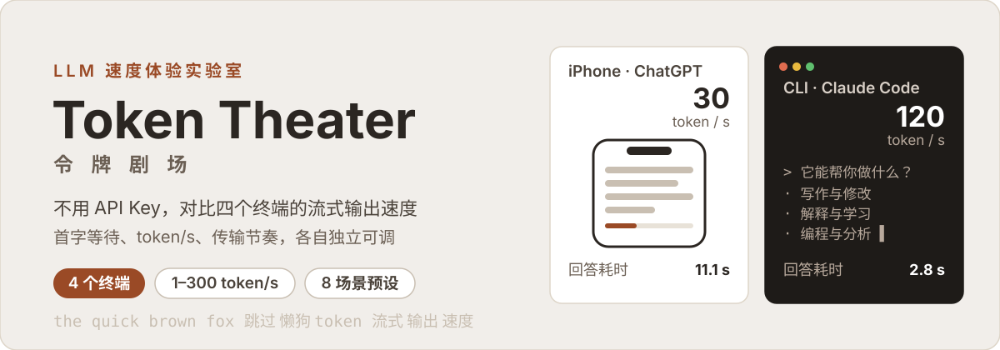
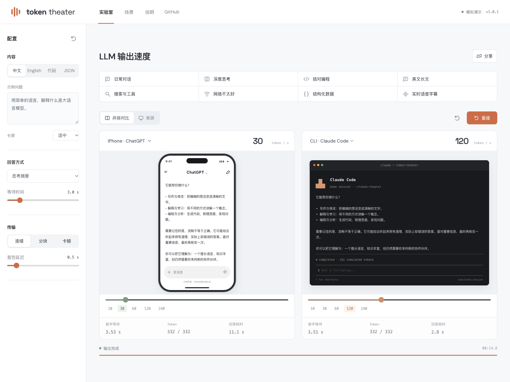

<p align="right"><a href="README.md">中文</a></p>

<p align="center">
  
</p>

<p align="center">
  <a href="https://xiaosang.cc/token-theater/">▶ Try Online</a>
  ·
  <a href="https://github.com/holynova/token-theater">GitHub Repository</a>
</p>

Token Theater is an LLM streaming simulator that needs no API key: play the same answer on two terminals side by side and feel how token speed, first-token delay, thinking states, and delivery cadence change the experience. Four terminal interfaces, eight scenario presets, all with prepared samples — no model is ever called.

## Screenshot

<p align="center">
  
</p>

## Features

- **Four terminals**: iPhone · ChatGPT, CLI · Claude Code, Web · Chatbot, macOS · Codex, each keeping its platform's interface language (Dynamic Island, terminal prompt, window controls, and so on).
- **Synchronized side-by-side comparison**: pick a terminal and speed for each side and play the same content in sync; switch to a single screen to focus on one side.
- **Independent speeds**: 1–300 token/s per side, with quick presets of 10 / 30 / 60 / 120 / 240.
- **8 scenario presets**: 日常对话 (Daily Chat), 深度思考 (Deep Thinking), 结对编程 (Pair Programming), 英文长文 (Long English Text), 搜索与工具 (Search & Tools), 网络不太好 (Flaky Network), 结构化数据 (Structured Data), 实时语音字幕 (Live Voice Captions).
- **Four content types**: Chinese, English, TypeScript code, JSON; three output lengths.
- **Answer modes**: direct answer, thinking summary, thinking state only, simulated tool calls.
- **Delivery cadence**: continuous, chunked, or periodic network stalls; first-packet latency and thinking wait adjustable independently.
- **Playback controls**: pause, resume, replay; share any configuration via URL.
- **Live metrics**: time to first token, tokens emitted, and total answer time, all shown in real time.

## Notes

- The prompt input only changes the question shown in the interface; answers come from prepared samples and never call an LLM.
- The built-in token unit is a deterministic demo segmentation; it does not claim to match any real model's tokenizer.
- Sample thinking summaries are illustrative, not a model's internal reasoning; the voice scenario simulates captions only, with no audio output.
- The branded interfaces are independent style demos and may differ from the products' current versions.

## Run Locally

Static HTML/CSS/JavaScript, zero build, zero dependencies:

```bash
npm run dev
# Open http://localhost:4317
```

Fonts load online; system fonts are used if loading fails.

## Tests

```bash
npm test            # 4 core timing tests, all passing
node --check dist/app.js
```

Tests cover lossless segmentation of mixed Chinese/English text, separation of first-packet and thinking phases, trailing-batch flushing in bulk output, and network stalls.

## Tech

- A deterministic segmentation and timing engine (`dist/engine.js`): the same configuration always plays the same way.
- Verified on desktop and 390px mobile; on mobile the two screens stack vertically.

```
dist/index.html       Interface and how-it-works notes
dist/style.css        Four terminal styles and responsive layout
dist/app.js           Samples, scenarios, interactions, sharing
dist/engine.js        Deterministic segmentation and timing functions
tests/engine.test.js  Timing boundary tests
```

## References

- [OpenAI reasoning models](https://developers.openai.com/api/docs/guides/reasoning)
- [Anthropic Claude Code](https://www.anthropic.com/news/enabling-claude-code-to-work-more-autonomously)
