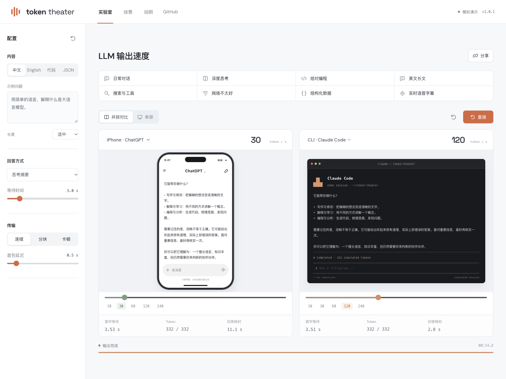

# Token Theater · LLM 速度体验实验室

一个不需要 API Key 的多终端流式输出模拟器。用于展示与讨论 token/s、首字等待、思考状态和传输节奏如何影响主观体验。

Compare simulated LLM streaming across four interfaces: iPhone chat, a CLI, web chat, and a macOS app. Adjust token speed, first-token delay, and delivery cadence independently, or start with one of eight presets. The demo uses prepared samples and needs no API key.



- [GitHub Repo](https://github.com/holynova/token-theater)
- Cloudflare Demo（部署验证中）: [token-theater.xiaosang.cc](https://token-theater.xiaosang.cc/)


## 运行 / Run locally

```sh
npm run dev
```

打开 http://localhost:4317 。纯静态 HTML/CSS/JavaScript；无需安装依赖。字体在线加载，失败时使用系统字体。

## 功能

- iPhone / ChatGPT、CLI / Claude Code、网页 chatbot、macOS / Codex 风格界面。
- 双端同步对比、单屏体验、1–300 token/s 独立速度。
- 中文、英文、TypeScript、JSON；三档输出长度。
- 直接回答、思考摘要、仅思考状态、模拟工具调用。
- 连续、分块、周期性网络卡顿；独立首包和思考等待。
- 8 个场景预设，暂停、继续、重播，URL 配置分享。
- 语音场景仅模拟字幕，没有音频输出。

输入提示词只修改界面中的展示问题，回答由预置内容决定，不会调用 LLM。内置 token 单位独立于任何模型 tokenizer。示例思考摘要不是模型内部推理。品牌界面是独立的风格演示，可能与产品当前版本不同。

## 发布 / Deploy

```sh
npm run deploy:check
npm run deploy
```

Cloudflare Workers 提供 `dist/` 静态文件，绑定 `token-theater.xiaosang.cc`。从 GitHub `main` 的同一提交在本地执行部署。

## 验证

```sh
npm test
node --check dist/app.js
```

核心计时测试覆盖中英混合文本无损切分、首包与思考分离、批量输出尾批刷新、网络停顿。网页交互另经桌面和 390px 移动端浏览器验证。

## 文件

- `dist/index.html`：界面与原理说明。
- `dist/style.css`：四种终端与响应式样式。
- `dist/app.js`：示例、场景、交互、分享。
- `dist/engine.js`：确定性分词与计时函数。
- `tests/engine.test.js`：计时边界测试。

## 参考

- [OpenAI reasoning models](https://developers.openai.com/api/docs/guides/reasoning)
- [Anthropic Claude Code](https://www.anthropic.com/news/enabling-claude-code-to-work-more-autonomously)
